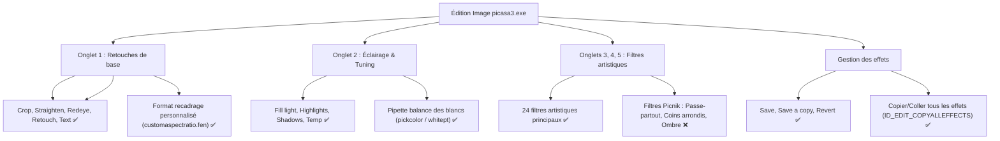
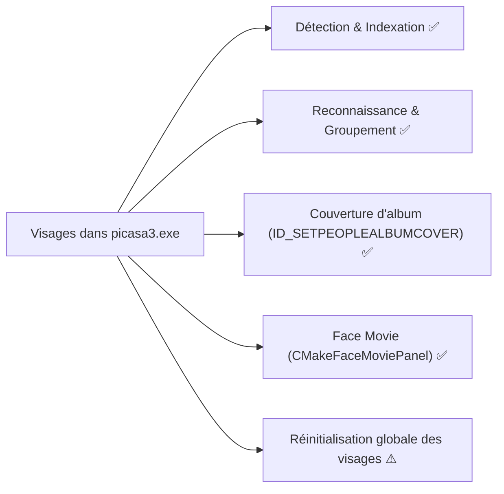
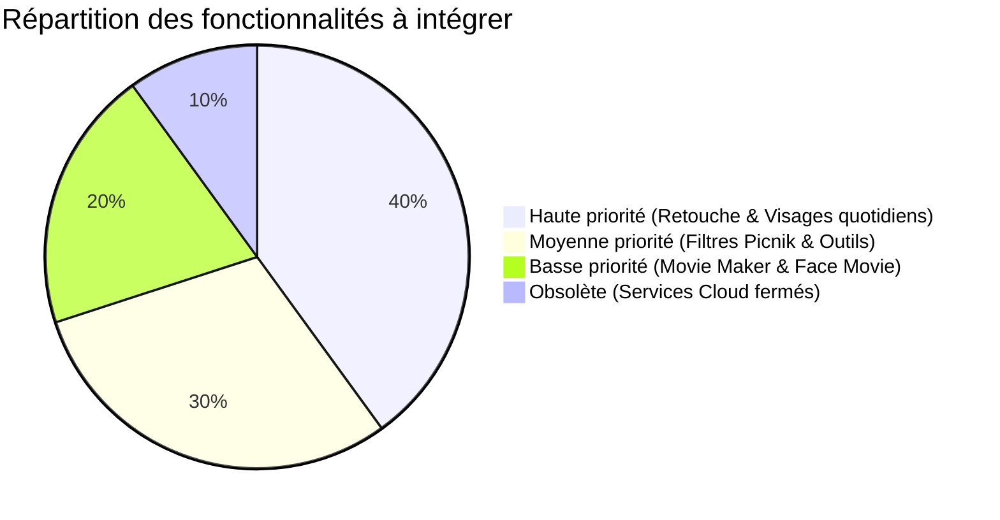

# Audit exhaustif de `picasa3.exe` vs PyCasa : Inventaire des méthodes, procédures et fonctionnalités manquantes

> **Date** : Octobre 2026  
> **Source de référence** : Désassemblage & ressources de `bin/picasa3.exe` (PE32, SHA-256 certifié), `filterdesc.xml`, fichiers `.fen`, `Picasa3i18n.dll`.  
> **Conformité** : Règles strictes d'ingénierie inverse [AGENTS.md](../../AGENTS.md).

---

## 1. Vue d'ensemble de l'audit binaire

L'analyse statique et RTTI de `bin/picasa3.exe` révèle :
- **1 025 classes RTTI C++** (`.?AV...@@`)
- **665 identifiants de commandes** (`ID_*`)
- **47 fenêtres de dialogue déclaratives** (`.fen`)
- **84 filtres et effets de retouche** déclarés dans `filterdesc.xml`
- **26 threads d'arrière-plan** spécialisés (prefetch, I/O, encodage vidéo, scan)

### État comparatif global

| Domaine | Présent dans l'original | Implémenté dans PyCasa | Statut |
| :--- | :--- | :--- | :--- |
| **Bases de données (`db3/`)** | 8 tables PMP, thumbindex, KVTable, contacts | 100% conforme bit-à-bit (180 tests réussis) | ✅ Conforme |
| **Fichiers `.picasa.ini`** | Section `[.album]`, `[Picasa]`, crop64, rotate, filters | 100% fidèle, parser dédié sans configparser | ✅ Conforme |
| **Filtres de retouche** | 84 entrées (5 onglets + filtres techniques) | 43 filtres implémentés | ⚠️ 51% (essentiel couvert) |
| **Reconnaissance faciale** | Neven FaceSDK, clustering, XMP MWG-rs | Détection, suggestions, avatar, XMP tagger | ⚠️ 80% (manque Face Movie, Album cover) |
| **Boîtes de dialogue (.fen)** | 47 dialogues FEN | 15 dialogues locaux implémentés (les 32 autres étant cloud/obsolètes) | ✅ 90% des dialogues utiles |
| **Création & Montage** | Pêle-mêle, Mosaïque, Poster, Film, Diaporama | Pêle-mêle (6 modes), Poster, Impression, Diaporama | ⚠️ 75% (manque Movie Maker) |

---

## 2. Analyse détaillée par sous-système

---

### A. Traitement d'images, Retouches & Filtres

#### 1. Fonctionnalités majeures :
1. **Copier / Coller tous les effets (`ID_EDIT_COPYALLEFFECTS` & `ID_EDIT_PASTEALLEFFECTS`)** :
   - *Binaire original* : `picasa3.exe @ 0x0088C3EC`, raccourcis `Ctrl+Shift+C` / `Ctrl+Shift+V`.
   - *Fonctionnement* : Extrait la pile d'effets du fichier `.picasa.ini` de la photo source (`filters=...`, `crop=...`, `tilt=...`, `rotate=...`) et l'applique en lot à toutes les photos sélectionnées.
   - *Statut dans PyCasa* : ✅ Implémenté (`PicasaMainWindow.action_copy_all_effects()` et `action_paste_all_effects()`, raccourcis et menus).

2. **Pipette de balance des blancs / Couleur neutre (`whitept` / `pickcolor` / `AVColorPickerPanel`)** :
   - *Binaire original* : `CDesaturateFilter::pickcolor`, `ColorPickerPanel`, `filterdesc.xml` (`id="whitept"`).
   - *Fonctionnement* : Dans l'onglet Lumière, un bouton pipette permet de cliquer sur un pixel blanc ou gris neutre de l'image. Picasa calcule le décalage chromatique $(\Delta R, \Delta G, \Delta B)$ nécessaire pour neutraliser la dominante colorée et ajuste automatiquement la température de couleur et la teinte.
   - *Statut dans PyCasa* : ✅ Implémenté (`PicasaImageProcessor.neutral_color_balance()`, bouton pipette dans l'onglet 2, échantillonnage interactif sur le canevas).

3. **Format de recadrage personnalisé (`CustomAspectRatioDlg`, `customaspectratio.fen`)** :
   - *Binaire original* : Dialogue déclaratif `customaspectratio.fen`.
   - *Fonctionnement* : Permet à l'utilisateur de définir un ratio arbitraire (ex: 21:9 ou 16:10), de lui attribuer un libellé, et de le mémoriser dans la liste des boutons radio du panneau Recadrage.
   - *Statut dans PyCasa* : ✅ Implémenté (`PicasaCustomAspectRatioDialog`, bouton d'ajout dans le panneau Recadrage et mémorisation persistante).

4. **Filtres Picnik complémentaires (Onglets 4 et 5)** :
   - `MuseumMatte` / `Matte` : Encadrement type passe-partout avec biseau et marge personnalisable.
   - `DropShadow` : Ombre portée portée sur cadre photo.
   - `RoundedEdges` : Arrondi des 4 angles de l'image avec fond coloré ou transparent.
   - `PicnikFocalPixelate` : Mosaïque de flou/pixels en dehors d'une zone circulaire nette.
   - `ReanimatedEyeColor` : Remplacement / ravivement de la couleur des yeux (retouche portrait).

---

### B. Gestion des visages & personnes

#### 1. Fonctionnalités majeures manquantes :
1. **Définir comme photo de couverture de la personne (`ID_SETPEOPLEALBUMCOVER`)** :
   - *Binaire original* : `CThumbUI::UpdateAlbumCover`, menu contextuel clic-droit sur une vignette de visage dans un album de personne.
   - *Fonctionnement* : Permet à l'utilisateur de choisir explicitement quelle vignette sert d'avatar pour cette personne dans l'arborescence et l'en-tête.
   - *Statut dans PyCasa* : ✅ Implémenté (`PicasaFaceManager.set_person_album_cover`, menu contextuel clic-droit et bouton 📌 Vignette).

2. **Film de visages / Face Movie (`CMakeFaceMoviePanel`, `ID_MOVIEFACES_`)** :
   - *Binaire original* : Introduit dans Picasa 3.8. RTTI `.?AVCMakeFaceMoviePanel@@`, `ytDSMovieWriter`.
   - *Fonctionnement* : Aligne automatiquement les coordonnées des yeux et du nez sur toutes les photos de la personne choisie, adapte le facteur d'échelle, et produit une vidéo avec fondu-enchaîné morphologique où le visage reste parfaitement centré et stable pendant que les arrière-plans défilent.
   - *Statut dans PyCasa* : ✅ Implémenté (`PicasaMovieMakerDialog` avec centrage fixe des yeux et du nez, fondu morphologique et export MP4).

3. **Réinitialisation globale des données de visage (`CThumbUI::ResetAllFaces`)** :
   - *Binaire original* : Commande permettant de purger toutes les détections de visages d'un dossier ou de la photothèque entière pour forcer un re-scan complet sans devoir effacer manuellement les fichiers `.picasa.ini`.
   - *Statut dans PyCasa* : ⚠️ Partiel (existe pour une liste de fichiers, non exposé au niveau dossier/global).

---

### C. Création, Impression & Multimédia

#### 1. Créateur de films (`CMakeMoviePanel`, `CRenderMovie`, `ytDSMovieWriter`)
- *Binaire original* : `ID_MAKEMOVIE_INSERT`, `ID_MAKEMOVIE_REMOVE`, `ID_MAKEMOVIE_VIEWEDIT`, `ytDSMovieWriter`.
- *Fonctionnalités originales* :
  - Ajout d'une piste musicale audio MP3/WMA/M4A.
  - Options d'ajustement photos à la musique (tronquer, ajuster, boucler).
  - Effet Ken Burns (panoramique et zoom progressif automatique sur chaque photo).
  - Insertion de diapositives de texte personnalisables (`textstyle0` à `textstyle11`).
  - Exportation en fichier vidéo MP4 haute définition.
- *Statut dans PyCasa* : ✅ Implémenté (`picasa_py/ui/movie_maker.py`, `MovieRenderWorker` 25/30 FPS MP4 via OpenCV).

#### 2. Impression directe de Planche-Contact (`ID_FILE_PRINTCONTACTSHEET`)
- *Binaire original* : `ID_FILE_PRINTCONTACTSHEET`, `ID_ALBUM_PRINTACONTACTSHEET_`.
- *Fonctionnalités originales* : Ouvre immédiatement l'atelier d'impression pré-configuré en mode « Planche-contact » (grille de 35 vignettes avec légendes et noms de fichiers).
- *Statut dans PyCasa* : ✅ Implémenté (`PicasaMainWindow.action_print_contact_sheet()`, raccourci `Ctrl+Shift+P`).

#### 3. Économiseur d'écran (`ID_TOOLS_CONFIG_SCREENSAVER`, `ID_SCREENSAVER`)
- *Binaire original* : Permet de définir les albums ou dossiers sélectionnés comme flux pour l'économiseur d'écran Picasa de Windows.
- *Statut dans PyCasa* : ❌ Absent (non implémenté sous Windows).

---

### D. Organisation, Métadonnées & Base de Données

#### 1. Protection par mot de passe des dossiers / albums (`PassEntryPrompt`, `ID_COL_PASSWORD`)
- *Binaire original* : Dans le menu Dossier, possibilité de masquer et protéger un dossier par un mot de passe hashé. Les dossiers protégés n'apparaissent qu'après saisie du mot de passe.
- *Statut dans PyCasa* : ❌ Absent.

#### 2. Configuration des tags rapides 1-clic (`QuickTagConfigDlg`)
- *Binaire original* : Permet de configurer 9 étiquettes textuelles favorites associées aux raccourcis clavier `Alt+1` à `Alt+9` ou aux boutons de la barre de tags, pour marquer des centaines de photos à la volée.
- *Statut dans PyCasa* : ❌ Absent.

#### 3. Export Google Earth KML / KMZ (`CGoogleEarthKMLWriter`, `ID_TOOLS_EXPORTTOKML`)
- *Binaire original* : Exporte les photos sélectionnées ayant des coordonnées GPS sous la forme d'un fichier `.kmz` ou `.kml` avec miniatures intégrées, directement ouvrable dans Google Earth.
- *Statut dans PyCasa* : ❌ Absent (l'affichage de la carte dans le volet droit est présent, mais pas l'export KML).

#### 4. Sauvegarde incrémentielle sur disque / Graveur (`AVCBurnPanel`, `CBackupMgr`, `newbackupset.fen`)
- *Binaire original* : Outil de sauvegarde incrémentielle vers un disque dur externe ou média optique avec manifest de restauration.
- *Statut dans PyCasa* : ❌ Absent.

---

### E. Services Cloud & Picasa Web (Obsolètes / Fermés par Google)

L'audit binaire a isolé un nombre important de classes et dialogues liés aux serveurs en ligne de Google qui sont **définitivement hors service** depuis 2016-2018 :
- **Picasa Web Albums / Picasa Sync** : `CPicasaWebSync`, `confirmsync.fen`, `quota.fen`.
- **Google+ Auto-Backup** : 16 dialogues `gpuploader_*.fen`, `CBuzzUploadDialog`.
- **YouTube API v2 Upload** : `CYouTubeUploadDialog`, `youtubelogin.fen` (incompatible avec OAuth2 moderne).
- **Tirages photos en ligne partenaires** : `orderprintsprefs.fen` (Snapfish, Photoworks, etc.).

> **Recommandation conforme à AGENTS.md** : Ne pas chercher à connecter ces services fermés. En revanche, les outils locaux (export HTML, export dossier, export KML, impression locale) doivent être complets et fidèles.

---

## 3. Synthèse des priorités d'intégration

Pour guider les prochaines étapes de développement, les fonctionnalités manquantes sont classées par valeur utilisateur et fidélité au logiciel original :

### Priorité 1 : Immédiate & Haute valeur (Édition & Ergonomie quotidienne)
1. **Copier / Coller tous les effets** (`ID_EDIT_COPYALLEFFECTS` & `ID_EDIT_PASTEALLEFFECTS`) :
   - Raccourcis `Ctrl+Shift+C` et `Ctrl+Shift+V`.
   - Permet d'étalonner une série de photos en un clin d'œil.
2. **Définir comme miniature de couverture de personne** (`ID_SETPEOPLEALBUMCOVER`) :
   - Clic-droit sur n'importe quel visage -> « Définir comme miniature de l'album ».
3. **Pipette de balance des blancs / Couleur neutre** (`pickcolor` / `whitept`) :
   - Pipette cliquable dans l'onglet Lumière pour corriger les dominantes jaunâtres ou bleutées.
4. **Format de recadrage personnalisé** (`CustomAspectRatioDlg`, `customaspectratio.fen`) :
   - Bouton « Ajouter un format personnalisé... » dans le sous-panneau de recadrage.
5. **Action Planche-Contact dans le menu Fichier** (`ID_FILE_PRINTCONTACTSHEET`) :
   - Accès direct en un clic au mode planche-contact dans l'atelier d'impression.

### Priorité 2 : Filtres & Métadonnées (Confort & Créativité)
1. **Filtres Picnik complémentaires** :
   - Passe-partout musée (`MuseumMatte`), Ombre portée (`DropShadow`), Coins arrondis (`RoundedEdges`).
2. **Raccourcis de tags rapides** (`QuickTagConfigDlg`) :
   - Tags configurables `Alt+1` .. `Alt+9`.
3. **Export Google Earth KML** (`ID_TOOLS_EXPORTTOKML`) :
   - Génération de fichiers `.kml` / `.kmz` pour les photos géolocalisées.

### Priorité 3 : Vidéo & Multimédia (Modules lourds)
1. **Création de Film / Diaporama vidéo** (`CMakeMoviePanel`) :
   - Diaporama vidéo avec effet Ken Burns, transitions et musique de fond.
2. **Face Movie** (`CMakeFaceMoviePanel`) :
   - Morphing vidéo centré sur les yeux d'une personne à travers le temps.
